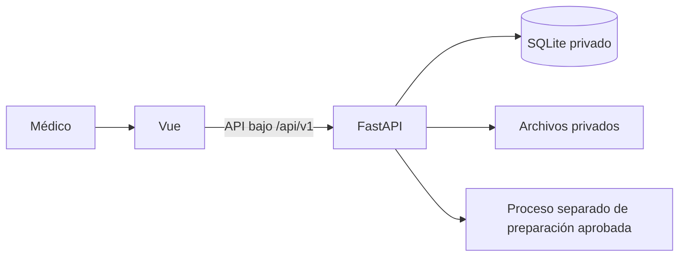

# Prototipo KneeOAI

## Estado actual de la fase 4

La versión 0.11 incorpora PWA instalable, actualización explícita, avisos de conexión y arranque local unificado. Conserva el acceso real, los datos basales y la preparación/revisión persistentes de fase 3. Vue se comunica con FastAPI y SQLite. La predicción de progresión sigue bloqueada; no se abre la prueba reservada.

Alcance y comprobaciones: [entrega de fase 4](FASE_4_ENTREGA.md). Publicación HTTPS e integración predictiva conservan sus fases propias.

La fase 6 tiene preparado su [primer paso de conexión técnica local](FASE_6_PASO_1_CONEXION_LOCAL.md): FastAPI puede comprobar modelos clínicos guardados en otro proceso, con diagnóstico ficticio y paridad verificada. La predicción para el médico continúa bloqueada; el paquete científico definitivo todavía no está liberado.

El [paso 2 neuronal](FASE_6_PASO_2_PREPARACION_NEURAL.md) prepara radiográfico y multimodal con un entorno CPU privado y metadatos verificados. La carga y ejecución de sus pesos entrenados esperan la descarga; la comprobación del entorno y del código no se presenta como prueba de esos modelos.

La preparación de fase 5 se versiona aparte en v0.12/API 0.5: [guía de despliegue](deploy/README.md), [estado general](FASE_5_PREPARACION.md) y [verificación Docker del 9 de noviembre](FASE_5_VERIFICACION_DOCKER.md). La construcción Linux, HTTPS, recreación y recuperación desde respaldo externo a otro volumen pasaron con datos ficticios. **La aplicación no está publicada en Internet.** No se contrató alojamiento ni dominio. El ensayo no sustituye ni migra la base local.



El preparador reutiliza el procedimiento científico congelado en un proceso y entorno separados: conserva píxeles nativos, muestra dos ventanas y prohíbe modificar manualmente el recorte. El centro visual se sella antes de llamar al localizador y nunca guía su cálculo. La revisión solo se acepta si lo permite el QC aprobado. El localizador no es el predictor de progresión. Sin sus activos privados configurados, la preparación se bloquea explícitamente.

## Verlo en esta computadora

Abrir **`app/IniciarKneeOAI.cmd`** con doble clic, o ejecutar desde la raíz del repositorio:

```powershell
.\app\IniciarKneeOAI.ps1
```

Se abre **`http://127.0.0.1:8000/acceso`**, servido por un único proceso local con la misma cuenta y base. El primer arranque compila la interfaz y conserva una copia verificada e inmutable; los siguientes reutilizan la distribución si las fuentes no cambiaron. Si el servidor ya está abierto, se reutiliza sin reconstruir ni recargar las ventanas. El iniciador no detiene otro proceso que ocupe el puerto.

En Edge o Chrome se puede usar el botón **Instalar KneeOAI**, cuando el navegador lo ofrezca, o la opción de instalar aplicación del navegador. La ventana instalada sigue necesitando el servidor local. `app/DetenerKneeOAI.cmd` detiene exclusivamente el proceso registrado por este iniciador; los datos guardados se conservan. Guardar el trabajo antes de detenerlo. Para actualizar el código local, cerrar las ventanas, detener el servicio y volver a iniciar; nunca se sustituyen los archivos de una distribución en uso.

La primera instalación de dependencias necesita Internet. Con el entorno y la distribución ya preparados, el servidor local puede funcionar sin Internet. La caché de la PWA contiene solo su interfaz pública: no guarda evaluaciones, sesiones, imágenes ni resultados. Si el servidor no responde, no se pueden confirmar guardados ni leer datos privados. Una actualización no recarga automáticamente ediciones pendientes; se solicita una decisión y se bloquea mientras haya una escritura o varias ventanas abiertas.

Para desarrollo se conserva la vista de Vite en `5173`, con backend separado; no es la dirección recomendada para instalar la PWA. Desde `app/frontend`:

```powershell
npm run dev
```

Las cuentas son administradas: no existe una contraseña pública ni un registro libre desde la pantalla. Para preparar expresamente una cuenta local con contraseña aleatoria, ejecutar desde `app/backend`:

```powershell
.venv\Scripts\python.exe scripts/prepare_local_demo.py
```

El archivo privado `app/backend/runtime/ACCESO_LOCAL.txt` contiene los accesos generados. El script conserva una copia existente; no restablece contraseñas silenciosamente. Este archivo, la base, los secretos y los registros quedan excluidos de Git. La cuenta no incluye casos: el usuario puede crear evaluaciones y utilizar Completar ejemplo en el formulario basal.

## Instalación desde una copia nueva

Se requiere Python 3.12 y Node compatible con `frontend/package.json`; la versión Node utilizada se registra en `.node-version`. Crear un entorno exclusivo del backend, sin utilizar los de entrenamiento.

Desde `app/backend`, con Python 3.12 disponible como `python`:

```powershell
python -m venv .venv
.venv\Scripts\python.exe -m pip install -r requirements.lock
.venv\Scripts\python.exe -m knee_app.cli init
.venv\Scripts\python.exe -m knee_app.cli create-user --email medico@example.invalid --name "Médico de demostración"
```

La creación solicita la contraseña de forma privada y con confirmación. En Linux se utiliza `.venv/bin/python`. Si Python tiene otro nombre o ruta, usar su ejecutable 3.12 al crear el entorno.

Desde `app/frontend`:

```powershell
npm ci --ignore-scripts
npm run test:contracts
```

Después, desde la raíz del repositorio, ejecutar `app/IniciarKneeOAI.ps1`. En otro sistema operativo compilar con `npm run build`, configurar `KNEEOAI_FRONTEND_DIST` con la ruta absoluta de `app/frontend/dist` e iniciar Uvicorn; los iniciadores `.cmd/.ps1` están destinados a Windows.

Vite reenvía `/api` al backend local. `.env.example` permite ajustar ese destino solo para desarrollo. Un despliegue requerirá enrutamiento bajo el mismo origen, HTTPS y almacenamiento persistente; el proxy local no configura un alojamiento.

Las condiciones de instalación se basan en [MDN](https://developer.mozilla.org/en-US/docs/Web/Progressive_web_apps/Guides/Making_PWAs_installable). El inicio local usa un origen loopback admitido; no sustituye el HTTPS del despliegue futuro.

## Qué se guarda y qué sigue pendiente

| Información | Comportamiento actual |
| --- | --- |
| Usuarios y contraseñas | Cuenta en SQLite; contraseña protegida con Argon2, nunca en el código del frontend. |
| Sesión | Cookie opaca del servidor, HttpOnly, con vencimiento y revocación; CSRF en memoria. |
| Edad, sexo, IMC y lado | Guardado explícito en SQLite; ausencias conservadas como null. |
| Código, propietario, versión y fechas | Asignados por el servidor; revisiones históricas transaccionales. |
| DICOM, matrices y vistas | Archivos privados persistentes; las vistas PNG requieren sesión, propietario y revisión vigente. |
| Referencia visual y decisión de calidad | SQLite y archivos asociados; referencia inmutable, observación, evaluación congelada, revisor y fechas. |
| Probabilidad y clasificación | Bloqueadas. No existe resultado sustituto ni modelo conectado. |
| Borradores locales de v0.8 | La copia permanece intacta y se avisa de su existencia. No se importa ni se sube automáticamente. |

Los formularios conservan los campos pendientes si falla una petición. Cada modificación exige la versión leída del caso; un conflicto no sobrescribe los cambios de otra sesión. La creación usa una clave por intención: repetir una petición cuyo resultado quedó incierto recupera el mismo caso, sin duplicarlo. Cambiar los datos con una clave ya aceptada produce un conflicto explícito.

Cerrar sesión revoca el acceso en el servidor y limpia el espacio de trabajo en memoria. Las respuestas tardías de una sesión anterior se descartan. La antigua marca de sesión simulada del navegador no concede acceso.

## Administración y respaldo

Desde `app/backend`:

```powershell
.venv\Scripts\python.exe -m knee_app.cli set-password --email medico@example.invalid
.venv\Scripts\python.exe -m knee_app.cli backup --package --destination runtime/backups/copia-nueva
.venv\Scripts\python.exe -m knee_app.cli restore --package --source runtime/backups/copia-nueva --destination runtime/restaurada-nueva
```

El paquete usa un snapshot consistente de SQLite e incluye todos los archivos referenciados y un manifiesto SHA-256/tamaños. La restauración exige destino nuevo, verifica integridad y revoca sesiones copiadas. Detener el servicio antes de adoptar su `application.sqlite3` y `private_objects`. Se rechaza una copia de solo SQLite cuando existen imágenes. Los detalles y la configuración privada del preparador están en `backend/README.md`.

## Comunicación y pruebas

`contracts/openapi.json` describe acceso, evaluaciones, preparación, referencia, reintento, vistas y QC implementados; la predicción sigue no disponible. La guía está en `contracts/README.md`.

Pruebas del backend, desde `app/backend`:

```powershell
.venv\Scripts\python.exe -m pip install -r requirements-dev.lock
.venv\Scripts\python.exe -m pytest tests -q
```

Pruebas de interfaz, desde `app/frontend`:

```powershell
npm run test:contracts
npm run build
npm run test:e2e
npm run test:pwa:unit
npm run test:pwa
```

En Windows local se usa Edge; con `CI=true` se usa Chromium, instalable con `npx playwright install chromium`. Linux CI utiliza `npx playwright install --with-deps chromium`. El backend de pruebas tiene base nueva y cuentas exclusivamente de prueba. Por defecto escucha en 8011 y la interfaz de pruebas en 5174; no se reutiliza el servidor del usuario. `E2E_API_PORT`, `E2E_PORT` y `KNEEOAI_TEST_PYTHON` permiten cambiar puertos o intérprete de prueba.

La suite activa verifica acceso real, aislamiento de cuentas, recarga, sesiones independientes, conflictos, fallos y reintentos, respuestas tardías y separación de la simulación. Las antiguas suites de acceso simulado y localStorage se conservan en `frontend/tests/history-v08/` y están excluidas: pertenecen a la entrega histórica 0.8, no al comportamiento actual. Las comprobaciones de HTTP están aisladas de Vue y usan respuestas interceptadas.

GitHub Actions tiene preparado el mismo flujo de contrato, compilación y pruebas con dependencias propias del backend. Su última ejecución remota quedó bloqueada por una restricción de la cuenta antes de ejecutar pasos; los resultados locales deben distinguirse del estado remoto.

## Organización del código

- `backend/knee_app/`: API, sesiones, validaciones, transacciones SQLite y administración local.
- `backend/tests/`: controles con bases temporales y datos ficticios.
- `backend/runtime/`: base y archivos privados de ejecución, excluidos de Git.
- `frontend/src/state/`: sesión, evaluaciones y preparaciones canónicas del servidor.
- `frontend/src/api/`: transporte y validación de respuestas de API.
- `frontend/src/demo/`: ilustraciones, definiciones y código histórico de demostración; el persistidor antiguo no está conectado a las pantallas actuales.
- `frontend/src/views/` y `components/`: pantallas y componentes Vue.
- `contracts/`: contrato versionado y ejemplos sintéticos.

El código público se mantiene en el repositorio Knee. Los datos de investigación, modelos, credenciales y artefactos privados conservan su almacenamiento restringido. Queda pendiente la publicación de fase 5 y, en fase 6, integrar el motor científico aprobado; la imagen de despliegue actual conserva preparación y predicción bloqueadas.
