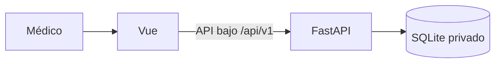

# Prototipo KneeOAI

## Estado actual de la fase 2

La versión 0.9 implementa acceso real y guardado de datos basales ficticios con Vue, FastAPI y SQLite. Cada cuenta tiene sus evaluaciones, recuperables al recargar o entrar desde otra sesión. La predicción sigue bloqueada; esta aplicación no carga modelos, importa el pipeline científico ni abre la prueba reservada.



La preparación de radiografías, el QC científico y la inferencia se implementarán en sus fases correspondientes, reutilizando `src/knee`. El catálogo SVG y las decisiones de revisión actuales son una simulación de interfaz en memoria: no se guardan como imágenes o aprobaciones reales en el servidor.

## Verlo en esta computadora

La interfaz se abre en `http://127.0.0.1:5173/acceso`. El servidor local escucha en `127.0.0.1:8000`. Se necesitan ambos procesos.

Si el entorno ya está instalado, desde la raíz del repositorio, iniciar el backend en segundo plano con:

```powershell
.\app\IniciarServidor.ps1
```

En otra terminal, desde `app/frontend`:

```powershell
npm run dev
```

Las cuentas son administradas: no existe una contraseña pública ni un registro libre desde la pantalla. Para preparar expresamente una cuenta local con contraseña aleatoria, ejecutar desde `app/backend`:

```powershell
.venv\Scripts\python.exe scripts/prepare_local_demo.py
```

El archivo privado `app/backend/runtime/ACCESO_LOCAL.txt` contiene los accesos generados. El script conserva una copia existente; no restablece contraseñas silenciosamente. Este archivo, la base, los secretos y los registros quedan excluidos de Git. La cuenta no incluye casos: el usuario puede crear evaluaciones y utilizar Completar ejemplo en el formulario basal.

## Instalación desde una copia nueva

Se requiere Python 3.12 y Node compatible con `frontend/package.json`; la versión Node utilizada se registra en `.node-version`. Crear un entorno exclusivo del backend, sin utilizar los de entrenamiento.

Desde `app/backend`, con Python 3.12 disponible como `python`:

```powershell
python -m venv .venv
.venv\Scripts\python.exe -m pip install -r requirements.lock
.venv\Scripts\python.exe -m knee_app.cli init
.venv\Scripts\python.exe -m knee_app.cli create-user --email medico@example.invalid --name "Médico de demostración"
.venv\Scripts\python.exe -m uvicorn knee_app.api:create_app --factory --host 127.0.0.1 --port 8000
```

La creación solicita la contraseña de forma privada y con confirmación. En Linux se utiliza `.venv/bin/python`. Si Python tiene otro nombre o ruta, usar su ejecutable 3.12 al crear el entorno.

Desde `app/frontend`:

```powershell
npm ci --ignore-scripts
npm run test:contracts
npm run dev
```

Vite reenvía `/api` al backend local. `.env.example` permite ajustar ese destino solo para desarrollo. Un despliegue requerirá enrutamiento bajo el mismo origen, HTTPS y almacenamiento persistente; el proxy local no configura un alojamiento.

## Qué se guarda y qué sigue simulado

| Información | Comportamiento actual |
| --- | --- |
| Usuarios y contraseñas | Cuenta en SQLite; contraseña protegida con Argon2, nunca en el código del frontend. |
| Sesión | Cookie opaca del servidor, HttpOnly, con vencimiento y revocación; CSRF en memoria. |
| Edad, sexo, IMC y lado | Guardado explícito en SQLite; ausencias conservadas como null. |
| Código, propietario, versión y fechas | Asignados por el servidor; revisiones históricas transaccionales. |
| Imagen SVG y revisión de ejemplo | Solo memoria de la interfaz; se reinician al recargar, cerrar sesión o cambiar la revisión basal. No son QC científico. |
| Probabilidad y clasificación | Bloqueadas. No existe resultado sustituto ni modelo conectado. |
| Borradores locales de v0.8 | La copia permanece intacta y se avisa de su existencia. No se importa ni se sube automáticamente. |

Los formularios conservan los campos pendientes si falla una petición. Cada modificación exige la versión leída del caso; un conflicto no sobrescribe los cambios de otra sesión. La creación usa una clave por intención: repetir una petición cuyo resultado quedó incierto recupera el mismo caso, sin duplicarlo. Cambiar los datos con una clave ya aceptada produce un conflicto explícito.

Cerrar sesión revoca el acceso en el servidor y limpia el espacio de trabajo en memoria. Las respuestas tardías de una sesión anterior se descartan. La antigua marca de sesión simulada del navegador no concede acceso.

## Administración y respaldo

Desde `app/backend`:

```powershell
.venv\Scripts\python.exe -m knee_app.cli set-password --email medico@example.invalid
.venv\Scripts\python.exe -m knee_app.cli backup --destination runtime/backups/copia-nueva.sqlite3
.venv\Scripts\python.exe -m knee_app.cli restore --source runtime/backups/copia-nueva.sqlite3 --destination runtime/restored/application.sqlite3
```

La copia usa la API de SQLite para obtener un estado coherente. La restauración exige un destino nuevo, verifica el esquema e invalida sesiones anteriores. Para adoptar la base restaurada, detener el servicio, cambiar su configuración y arrancarlo; nunca sustituir una base abierta. Guardar copias fuera del servidor y verificar su recuperación corresponde al despliegue final. Los detalles de configuración y recuperación están en `backend/README.md`.

## Comunicación y pruebas

`contracts/openapi.json` distingue operaciones implementadas, preparación futura e inferencia no disponible. No todas las operaciones previstas existen todavía. La guía está en `contracts/README.md`.

Pruebas del backend, desde `app/backend`:

```powershell
.venv\Scripts\python.exe -m pip install -r requirements-dev.lock
.venv\Scripts\python.exe -m pytest tests -q
```

Pruebas de interfaz, desde `app/frontend`:

```powershell
npm run test:contracts
npm run build
npm run test:e2e
```

En Windows local se usa Edge; con `CI=true` se usa Chromium, instalable con `npx playwright install chromium`. Linux CI utiliza `npx playwright install --with-deps chromium`. El backend de pruebas tiene base nueva y cuentas exclusivamente de prueba. Por defecto escucha en 8011 y la interfaz de pruebas en 5174; no se reutiliza el servidor del usuario. `E2E_API_PORT`, `E2E_PORT` y `KNEEOAI_TEST_PYTHON` permiten cambiar puertos o intérprete de prueba.

La suite activa verifica acceso real, aislamiento de cuentas, recarga, sesiones independientes, conflictos, fallos y reintentos, respuestas tardías y separación de la simulación. Las antiguas suites de acceso simulado y localStorage se conservan en `frontend/tests/history-v08/` y están excluidas: pertenecen a la entrega histórica 0.8, no al comportamiento actual. Las comprobaciones de HTTP están aisladas de Vue y usan respuestas interceptadas.

GitHub Actions tiene preparado el mismo flujo de contrato, compilación y pruebas con dependencias propias del backend. Su última ejecución remota quedó bloqueada por una restricción de la cuenta antes de ejecutar pasos; los resultados locales deben distinguirse del estado remoto.

## Organización del código

- `backend/knee_app/`: API, sesiones, validaciones, transacciones SQLite y administración local.
- `backend/tests/`: controles con bases temporales y datos ficticios.
- `backend/runtime/`: base y archivos privados de ejecución, excluidos de Git.
- `frontend/src/state/`: sesión y evaluaciones canónicas del servidor; simulación temporal aislada.
- `frontend/src/api/`: transporte y validación de respuestas de API.
- `frontend/src/demo/`: ilustraciones, definiciones y código histórico de demostración; el persistidor antiguo no está conectado a las pantallas actuales.
- `frontend/src/views/` y `components/`: pantallas y componentes Vue.
- `contracts/`: contrato versionado y ejemplos sintéticos.

El código público se mantiene en el repositorio Knee. Los datos de investigación, modelos, credenciales y artefactos privados conservan su almacenamiento restringido. La siguiente fase añadirá carga y preparación de imagen manteniendo el procedimiento científico autorizado.
